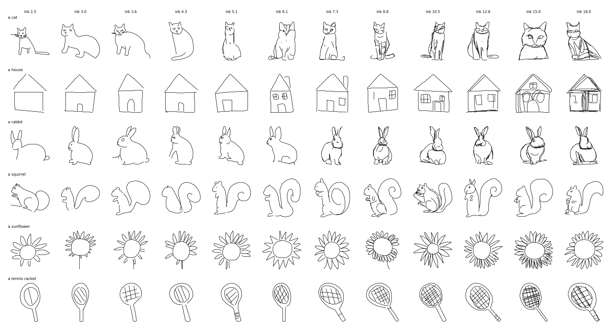

  

  

  

  

  <a href="" id="linkbutton" target="_blank">Read the paper</a>
  <a href="https://github.com/greydanus/pengpt" id="linkbutton" target="_blank">Get the code</a>
  <a href="https://github.com/greydanus/pengpt" id="linkbutton" target="_blank">Download weights</a>

## Tokenizing Pen Strokes

## Steering a Pen Stroke Model

## Data Quality

  
  

  Quick, Draw!
  Sketchy
  ControlSketch
  Line icons
  THINGS
  SEVA
  TU-Berlin
  CreativeSketch
  PhotoSketch
  DifferSketching

## Samples

#### Fitting someone's handwriting

  

  

## Discussion

Cursive handwriting is a unique, small-scale sequence modeling problem that can serve as a rich testbed for sequence modeling research. It is also a culturally-significant art form that people use to express emotions and personality. We believe that it is understudied in machine learning, and in this work we have sought to remedy that problem by introducing a new dataset and training a simple GPT-style model to generate realistic cursive handwriting. The results are among the best we have seen for pen-stroke models and are competitive with the best image-based methods. We believe that they also contain broader insights about how Transformers can be used for modeling niche data modalities.

