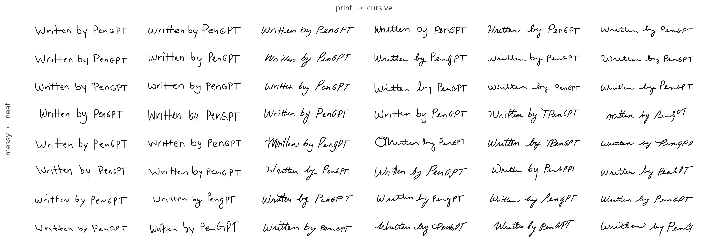
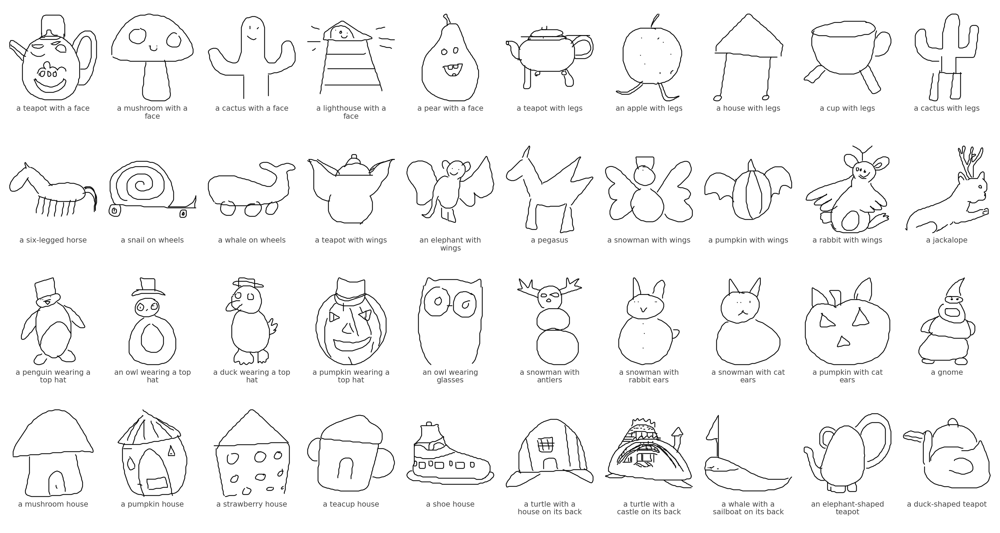

  
  

    <b>Left.</b> One sentence in eight of the model's 1,192 hands, each a single learned vector. <b>Right.</b> The best of ten samples per prompt. The bottom six prompts appear nowhere in the training captions.
  

  <a href="" id="linkbutton" target="_blank">Read the paper</a>
  <a href="https://github.com/greydanus/pengpt" id="linkbutton" target="_blank">Get the code</a>
  <a href="https://github.com/greydanus/pengpt" id="linkbutton" target="_blank">Download weights</a>

Last year Zach Wimpee and I trained a tiny GPT to [write cursive](/2025/03/30/cursive-transformer/). The trick was a custom tokenizer that turned pen strokes into tokens, after which a plain Transformer did the rest. It worked, but the model knew exactly one hand, mine: its whole training set was 3,500 words that I had written on a trackpad.

In this post I want to see what happens when we keep the idea and change the data. PenGPT is a small Transformer that emits pen strokes one token at a time, the way a language model emits words. The same code, trained on two datasets, gives two models. The handwriting model (5M parameters) writes any text in any of 1,192 hands and can pick up a new hand from a photo of a few words. The drawing model (54M parameters) draws what a phrase describes, including some things it was never shown.

Both train in minutes on eight A100s (five for handwriting, 73 for drawings) and pack into 4 MB and 44 MB files that run on a laptop with numpy alone.

## Tokenizing Pen Strokes

**Strokes as a walk.** The Cursive Transformer gave each pen movement a direction token and a length token. PenGPT first snaps the pen's path to a grid, so that all motion becomes a walk between neighboring cells. That walk needs just ten symbols: the eight compass directions, plus `DOWN` and `UP` for the pen touching and leaving the page.

**Merging moves into strokes.** A walk written one cell at a time is long and repetitive, so we borrow the standard remedy, byte-pair encoding: merge the most common pair of adjacent symbols into a new token, and repeat. The first merges are straight runs, then come diagonals, and after those the bends and hooks that letters and outlines are made of. Handwriting gets 512 merges and drawings 1,024, where a typical token covers six moves.

  
  

    The grid size trades fidelity for length: "hope" costs 72 tokens at the finest grid and 41 at the coarsest. The handwriting model uses 0.02, about a sixth of the height of a lowercase letter.
  

**Telling the model where the pen is.** Every token is a relative move, so each one also carries sines and cosines of the pen's position. For drawings the position also enters self-attention as a rotary encoding, so that strokes near each other on the page attend to each other however far apart they are in the sequence. Otherwise the model is a plain decoder in the style of nanochat, with cross-attention over whatever it is told.

## Steering a Pen Stroke Model

**Handwriting.** The model cross-attends to a short context: the bytes of the text plus one learned vector for the writer. Since a hand is just a vector, we can learn a new one from a photo: I trace the clearest eight words back into pen strokes and fit a single new vector to them with the rest of the model frozen. The temperature is set from how unpredictable the photo's ink is to the model, so a hurried note comes out hurried.

  
  

    Forty-eight hands, from print to cursive across. The top two rows are sampled greedily, so every difference between them comes from the writer vector alone. Below that the temperature rises to 0.65 and the letters loosen.
  

**Drawings.** The context is a single SigLIP 2 vector: of the drawing's picture, its label, or one of its captions. Because SigLIP places pictures and text in one space, a typed sentence can stand in for any of them. Beside it sits a learned vector for the dataset the drawing came from, which in practice selects a manner of drawing. One drawing in ten is trained with nothing told, which lets us push a sample towards its words with guidance. One in five is told how much ink and how many strokes it contains, so that we can ask for a sparse or a detailed drawing of the same thing.

  
  

    As more ink is requested, the house gains a door, then windows, then a chimney, and the racket's strings turn into a cross-hatch. At the far right the model has run out of parts to add and starts going over its own lines.
  

## Data Quality

Between them the two models saw close to a million examples: 477,670 drawings and about 496,000 handwritten words.

**Choosing which drawings to keep.** Quick, Draw! holds 50 million drawings, and many are scribbles. To filter them I had Claude rate about 25,000 drawings from one to ten, judging how well a thing is drawn and not how much of it. A small probe on image embeddings learned to predict those ratings, which made it cheap to score all 50 million. I kept the best half a percent, balanced across classes.

**Describing them.** A label like "cat" is not much to steer by. So Claude was shown each drawing in stages, in the order it was drawn, and wrote a name, a sentence about the whole, and one instruction per stage. Then a model that could not see the drawing rewrote that record in more than a dozen registers, from "some kind of flying craft" to "please draw an airplane flying to the right". Each drawing is thus described about twenty ways, so a prompt in almost any phrasing lands near something the model knows.

  
  

  Quick, Draw!
  Sketchy
  ControlSketch
  Line icons
  THINGS
  SEVA
  TU-Berlin
  CreativeSketch
  PhotoSketch
  DifferSketching

  

    Held-out drawings, shown to the model with no prompt and placed by its activations. Line icons and ControlSketch form tight blocks, while Quick, Draw! and SEVA run together. The model sorts drawings first by how they were drawn and only then by what they show.
  

**Handwriting from paper.** A pen model needs strokes, and almost all handwriting is on paper. Most of the words come from two research collections in which hundreds of volunteers copied out the same passages. The rest come from archives, where a scout graded about 4,600 scanned documents and notebooks, and 98 passed. Each page was transcribed and cut into words, and each word was traced back into pen strokes with InkSight.

**Checking every trace.** Tracing fails often, so every traced word is drawn again and compared with its source: it must cover at least 80% of the ink and read back as the right word. Fine pens fare worst. A letter by Abraham Lincoln graded 8 out of 10 for legibility, but only 14 of its 30 traced words survived. The data and this pipeline are not part of the release.

## Samples

#### Drawing things it was never shown

  
  

    Four kinds of unseen prompt that work, one per row: a face or legs on an object, wheels and wings, hats and ears, and one thing shaped like another. None depends on word order, so a blend of two familiar ideas is enough.
  

I gave the drawing model 252 unusual prompts and looked through about 2,300 drawings. The kinds in the figure above are reliable, and top hats and glasses work about half the time. An animal doing something mostly fails, as do crowns and scarves, and "facing left" gives the same drawing as "facing right".

**Blending versus binding.** The model fails where words must be bound to each other: who wears what, what is on what. I think the cause is the conditioning and not the data. A pooled SigLIP vector is close to a bag of words -- "a cat facing left" and "a cat facing right" have a cosine similarity of 0.999. So the cat riding a bicycle at the top of this post was a lucky sample.

#### Fitting someone's handwriting

  
  

    A paragraph printed on a NIST handwriting form in 1989, by a writer the model never saw. Fit from eight words, the hand keeps the wide letter spacing and the tall J. The model's copy also keeps "genera" and "posteri", words that the cutting step clipped.
  

  
  

    A letter by the poet Sara Teasdale. One vector carries her slant and long looped descenders into words she did not write.
  

## Discussion

The architecture changed very little between the Cursive Transformer and PenGPT. What changed was the data, which grew from 3,500 words by one writer to about half a million words by 1,192 writers, plus nearly as many drawings. Most of my time went into deciding what the model should see. I suspect that is where most of the improvement came from, though I have not yet run the ablations to separate the data's contribution from the tokenizer's.

The failure I find most interesting is composition, because it points at a specific cause. If a pooled vector is the bottleneck, then letting the drawing model read its caption as a sequence of tokens, as the handwriting model already reads its text, should teach it left from right without any new data. That is the next experiment.

More broadly, pen strokes are an underused testbed. They need a tokenizer, they separate style from content, and their mistakes are easy to see. These models also train in minutes, which is the same reason I like [MNIST-1D](/2020/12/01/scaling-down/).
