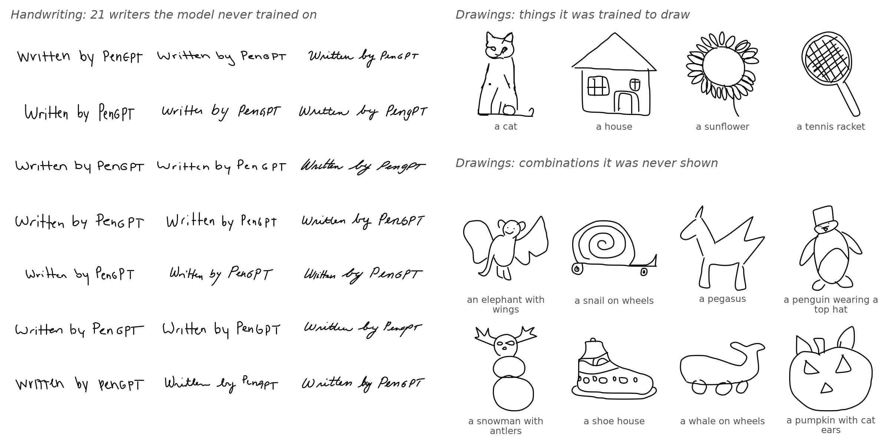
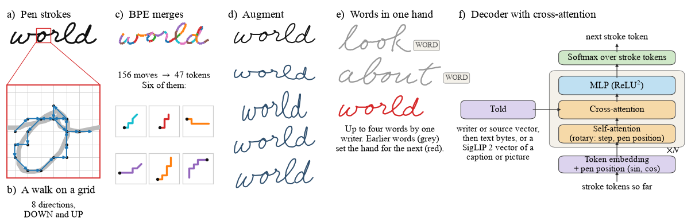
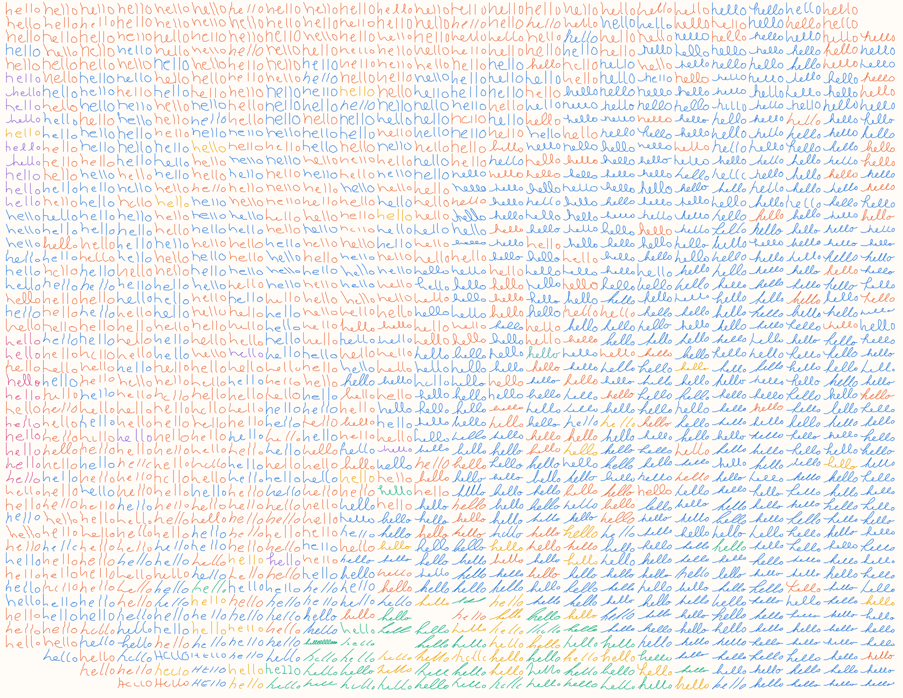
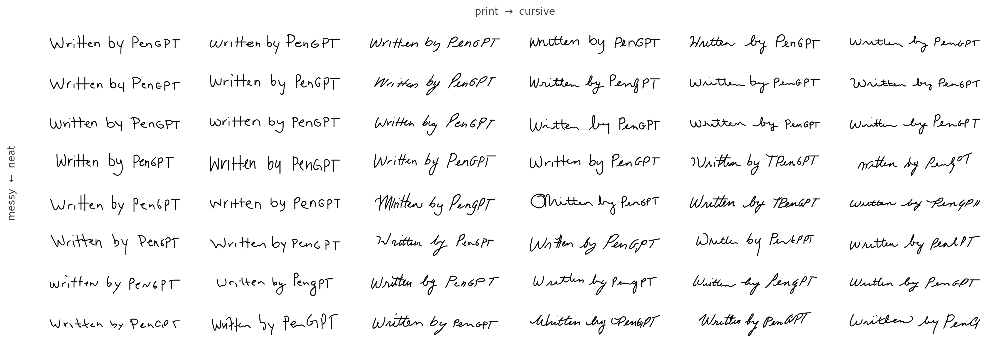
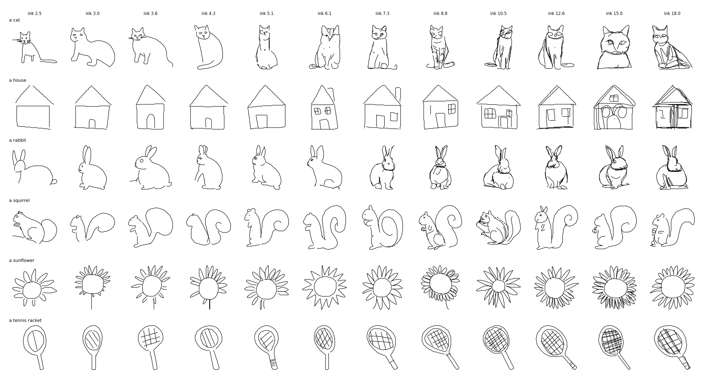
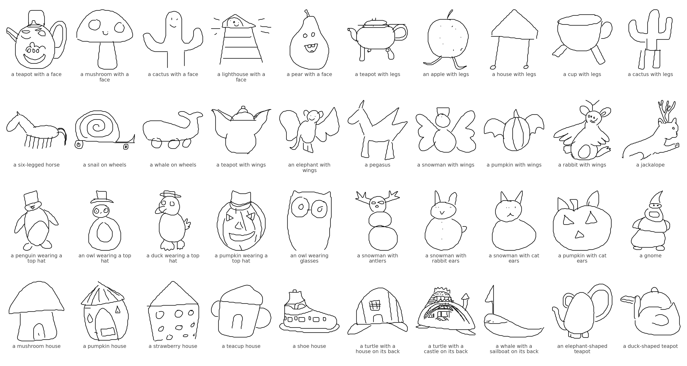
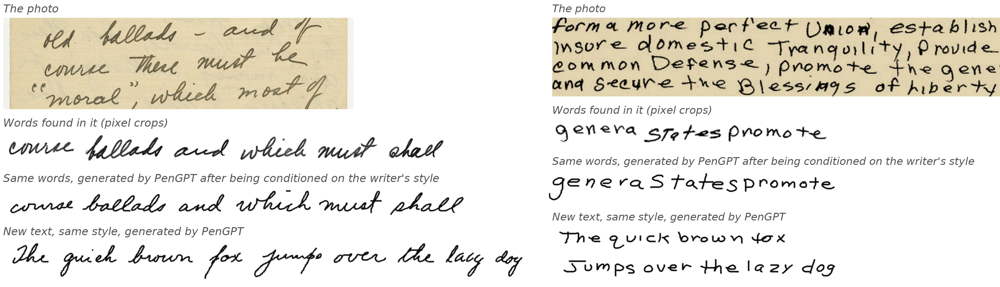
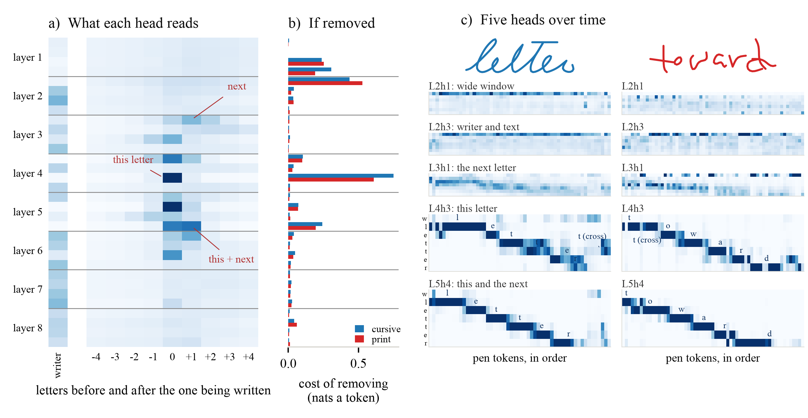
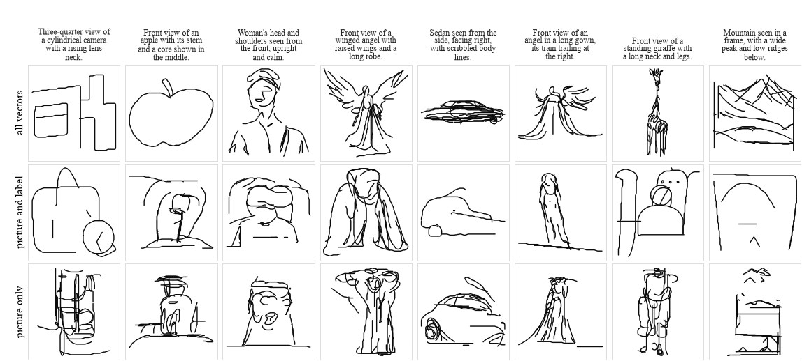
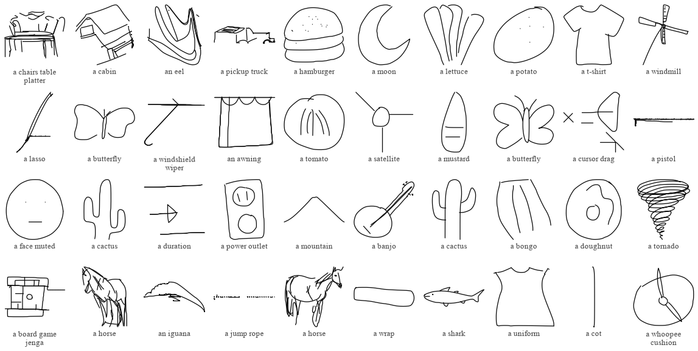

{{ page.excerpt | strip_html }}

  
  

    <b>Left.</b> One phrase in the hands of 21 writers who were held out of training. The model read one to three real words by each of them and carried on in their hand. <b>Right.</b> Drawings from typed prompts. I picked these by eye from the best third of the samples; there are unpicked ones further down.
  

  <a href="/assets/pengpt/pengpt.pdf" id="linkbutton" target="_blank">Read the paper</a>
  <a href="https://github.com/greydanus/pengpt" id="linkbutton" target="_blank">Get the code</a>
  <a href="https://github.com/greydanus/pengpt/releases" id="linkbutton" target="_blank">Download weights</a>

Last year Zach Wimpee and I trained a tiny GPT to [write cursive](). It worked but it only knew one hand (mine) and it learned from 3,500 words that I wrote on a trackpad.

So here's the obvious next question: can one small, ordinary transformer learn to hold a pen in lots of hands and draw as well as write? PenGPT is my attempt. There are two models. A 6M-parameter one writes print and cursive and picks up the handwriting of someone it has never seen from a few of their words. A 54M-parameter one draws from a text prompt.

Then I took the thing apart to find out why it works. The answer wasn't what I expected.

## How it works

  
  

    The whole recipe. Pen points snap to a grid (b) so a word becomes a walk in eight directions plus pen-down and pen-up. Byte-pair encoding merges common runs of moves into tokens (c): this "world" goes from 156 moves to 47 tokens. Everything else is a plain decoder that cross-attends to what it's told.
  

That's it for the modality-specific part: ten symbols and a merge count. The same tokenizer handles handwriting and drawings. For handwriting the model is told the text; for drawings it's told a SigLIP 2 vector so a typed phrase can stand in for a picture.

## The data

Almost nobody records pen strokes so I made the handwriting data from scans: 495,590 words by 1,255 writers, mostly from two research collections plus old letters and diaries from public archives. A vision-language model finds legible pages and transcribes them, the pages get cut into words, InkSight traces each word back into strokes and a set of checks throws out bad traces. Between a third and a half of the words survive.

The drawings are 477,670 sketches from ten public datasets. Quick, Draw! has 50 million and I kept the best 0.5%. I'm not releasing the datasets but the paper's appendix explains how to build them.

  
  

    Every writer the model knows, saying hello. Each one is placed by its learned vector, with print on the left and cursive on the right. Nobody told the model which was which. Color is the source the pages came from.
  

## Training a model

I compared PenGPT with older approaches then changed one thing at a time and retrained. Here are the rows I found most interesting; the paper has the rest.

<table class="ptable">
  <tr><th>Handwriting</th><th>Score change</th><th>Style rank</th><th>Legible</th></tr>
  <tr><td>Graves-style LSTM, same tokens</td><td>+0.029</td><td>2.2</td><td>49%</td></tr>
  <tr><td>ScribeTokens BPE, 60x the vocabulary</td><td>&minus;0.001</td><td>1.9</td><td>53%</td></tr>
  <tr class="base"><td>PenGPT</td><td>0.716</td><td>1.9</td><td>54%</td></tr>
  <tr><td>A tenth of the data</td><td>+0.050</td><td>3.0</td><td>47%</td></tr>
  <tr><td>No augmentation</td><td>+0.028</td><td>2.0</td><td>52%</td></tr>
  <tr><td>One word per sequence</td><td>+0.009</td><td>6.0</td><td>52%</td></tr>
  <tr><td>No pen position</td><td>+0.001</td><td>1.9</td><td>52%</td></tr>
  <tr><td>No BPE merges</td><td>&minus;0.010</td><td>&ndash;</td><td>55%</td></tr>
  <tr><td>Twice the parameters</td><td>&minus;0.004</td><td>1.9</td><td>55%</td></tr>
  <tr><td>Real ink</td><td></td><td></td><td>66%</td></tr>
</table>

<table class="ptable">
  <tr><th>Drawings</th><th>Score change</th><th>Matches label</th><th>Matches caption</th></tr>
  <tr><td>sketch-rnn-style LSTM, same tokens</td><td>+0.049</td><td>40%</td><td>20%</td></tr>
  <tr><td>Trained on Quick, Draw! only</td><td>+0.002</td><td>74%</td><td>37%</td></tr>
  <tr class="base"><td>PenGPT</td><td>0.591</td><td>76%</td><td>43%</td></tr>
  <tr><td>No augmentation</td><td>+0.013</td><td>4%</td><td>6%</td></tr>
  <tr><td>No pen position</td><td>+0.008</td><td>74%</td><td>40%</td></tr>
  <tr><td>Half the layers, half the width</td><td>+0.022</td><td>62%</td><td>31%</td></tr>
</table>

  Rows above the line are comparisons with other approaches; rows below it each change one thing about PenGPT. Score is nats per pen move on held-out data, lower is better; the base rows vary by about 0.001 between seeds. Style rank is how well the model tells whose hand it is continuing (1 is perfect, 8.5 is chance). Legible is how often an OCR model reads a sampled word exactly. The drawing columns are how often SigLIP 2 picks a drawing's own prompt out of a few hundred.

**Data and how you show it.** Those are the big rows. Cut the data and everything gets worse. Drop augmentation and the drawing model stops following its prompts entirely. Train on one word at a time and the model can no longer pick up a hand: style rank goes from 1.9 to 6.0.

**The clever parts barely register.** Telling the model where its pen is does nothing for handwriting. The BPE merges I was proud of make the score slightly *worse*; they buy speed (sequences are 3.2x shorter) and that's all. A vocabulary sixty times larger changes nothing. Doubling the model changes nothing.

**Even the transformer is optional, sort of.** An LSTM on the same tokens is a bit behind on handwriting and still picks up new hands. On drawings, where sequences are several times longer, it falls well behind.

## Samples

Enough tables. Here's what the two models make.

  
  

    Forty-eight of the 1,192 hands it trained on. The top two rows are sampled greedily so the differences there are all the writer. Further down the temperature rises and the letters loosen.
  

The drawing model takes a few controls besides the prompt. One of them is how much ink to use.

  
  

    Six prompts, with more ink requested from left to right. The house gains a door, then windows, then a chimney and the racket's strings turn into a cross-hatch. At the far right the model has run out of parts to add and starts going over its own lines.
  

It can also draw some things it was never shown as long as a blend of two familiar ideas will do.

  
  

    Prompts that appear nowhere in the training data, one family per row: a face or legs on an object, wheels and wings, hats and ears and one thing shaped like another. I picked these from several tries each. None of them depends on word order, which turns out to matter (see the end of the post).
  

## Picking up a new hand

The trick is almost embarrassingly simple. Each training sequence holds up to four words by one writer. That teaches the model that later words look like earlier ones so at sampling time you hand it a few real words and it keeps going. No style encoder, no fine-tuning. That's how the 21 hands at the top of this post were written.

It also works from a photo. There are no strokes in a photo so I trace a few of its words with InkSight and fit one new writer vector to the traces, with the rest of the model frozen.

  
  

    Two hands learned from photos: a letter by the poet Sara Teasdale and a paragraph someone printed on a NIST form in 1989. From the top: the photo, words found in it, the model's copy of those words and new text in that hand. The printed copy keeps "genera", a word the cutting step clipped. The model copies what it's given.
  

## Reading the letters

  
  

    What the cross-attention heads read. <b>(a)</b> A few heads in layers 3 to 5 lock onto one position: this letter, the next letter or both. <b>(b)</b> Silencing the "this letter" head costs more than any other. <b>(c)</b> That head stepping through "letter" and "toward" as the pen writes them. Look at the t: it gets read twice, once for the stem and again for the cross and in cursive the cross doesn't come until the word is finished.
  

One head in layer 4 puts 81% of its attention on the letter being written. I looked for heads that specialize in cursive or print and found none; every head reads the same positions in both.

## Do you need captions?

Captions are the expensive part of the drawing data. Since SigLIP puts pictures and text in the same space, maybe you could train on picture vectors alone and type a prompt at the end?

  
  

    Eight held-out phrases, each drawn once by three models, nothing picked. Top: trained on pictures, labels and captions. Middle: pictures and labels. Bottom: pictures only.
  

You can't. The picture-only model has the *best* likelihood of the three and it draws scribbles. The reason is geometric: SigLIP's vectors for sketches sit in a narrow cone, nearly at right angles to its vectors for text. A model that has only seen the cone is lost when you hand it a sentence. Labels are enough to draw labels (78%) but only captions get you phrases (43% against 10%).

## What it can't do

  
  

    Forty random labels, one draw each, nothing picked. This is the honest version of the figure at the top.
  

The drawing model blends but doesn't bind. A teapot with a face is fine. Who wears the hat is not and "facing left" gives the same drawing as "facing right" because the single vector it's told is close to a bag of words (those two captions have a cosine similarity of 0.999). Sampled handwriting is also less legible than the real thing, 54% against 66%. And since most of the handwriting was traced from scans, its stroke order is a model's guess and not a record.

## Closing thoughts

If you look over my blog, you'll notice that many of my projects revolve around clever ideas. I fell in love with them because they were elegant. That isn't a flaw in itself but I think Rich Sutton was wise to warn about it in [The Bitter Lesson](http://www.incompleteideas.net/IncIdeas/BitterLesson.html). It really is bitter and it has taken me more time than I'd like to admit to embrace it.

I think this post is my first step in the right direction. The results are interesting and the project was a pleasure to work on. And yet there was no clever architectural idea behind it. About 80% of my effort went into building the biggest, cleanest datasets possible and doing lots of quality control on them. Another 15% went into finding a decent 8xA100 node and getting my models to train fast and in parallel on it: 8 minutes for the handwriting model and about 35 for the sketch model. My previous attempt, the Cursive Transformer, took upwards of 10 hours on an A100 and only ever learned one hand. The tokenizer I used here is much simpler and far less elegant but it just works.

The bitter lesson kills or sidelines a lot of beautiful research ideas. It's like gravity: it constrains you and most of the time it's a very bad idea to fight back. But as I accept it and begin to work *with* it, I find things to admire. As a physicist I'm fascinated by the emerging science of scaling laws. And as a lover of biology I like the idea of putting a ton of work into the data and then literally growing a model on it, as you would an organism. Then you get to interact with it, learn what it's capable of and study how it works. Seen this way, the bitter lesson has its own charm.
